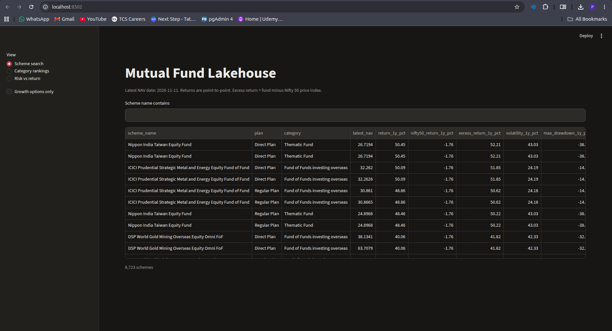

# Mutual Fund Lakehouse

A data pipeline and dashboard for Indian mutual funds, built on free tiers only.
It pulls daily NAVs, index prices, expense ratios (TER) and AUM from public sources,
stores them in a Databricks lakehouse, models them with dbt, and serves the results
through a Streamlit dashboard.



## What it answers

- How has each scheme done over 1 month, 3 months, 6 months and 1 year?
- Did an equity Growth fund beat the Nifty 50 price index over the same dates?
- Where does a fund rank inside its category, per plan (Direct or Regular)?
- How bumpy was a fund over the last year (volatility), and how deep was its worst fall (max drawdown)?

Headline (latest NAV date in the data, Growth options only): 1,037 active equity Growth
schemes have a 1-year return. 858 of them (83%) beat the Nifty 50 price index, by 5.7 points on average.
That figure is flattered, because the index used ignores dividends (see *Known limits*).

## Architecture

```
AMFI (NAV, AUM, TER) ─┐                          ┌─> S3 archive (landing/)
Yahoo Finance (index) ┼─> extract -> data/landing┤
                      │                          └─> Databricks Volume
                      │                                     │
                      │                              Auto Loader (bronze_ingest job)
                      │                                     │
                      │                              bronze  (append-only Delta)
                      │                                     │
                      │                              dbt silver  (staging, intermediate)
                      │                                     │
                      │                              dbt gold    (dim_scheme, fct_*)
                      │                                     │
                      └──────────────────────────── Neon mf_serving (read-only role)
                                                            │
                                                    Streamlit dashboard
```

Airflow runs the whole chain every day at 22:30 IST. It is the orchestrator, and each step is a task:
extract NAV, index prices and TER; upload to S3 and the Volume; start and wait for the bronze job;
check source freshness; dbt build (models and tests) on the `prod` target; publish gold to Neon.

## Data sources

| Source | What | How it's fetched |
|---|---|---|
| AMFI NAV (`NAVAll.txt`, NAV history report) | Daily NAV for every scheme; history for gaps and late revisions | HTTP, daily file plus 7-day history lookback |
| AMFI AUM (monthly report) | Assets under management by category | XLS, one month at a time |
| AMFI TER (expense ratio) | Regular and Direct total expense ratios | AMFI's Excel export API |
| Yahoo Finance | Nifty 50 (`^NSEI`) and Sensex (`^BSESN`) closes | `yfinance` |

## Layers

| Layer | Schema | Contents |
|---|---|---|
| Bronze | `mf_lakehouse.bronze` | Raw Parquet loaded by Auto Loader. Append-only, with audit columns. |
| Silver | `mf_lakehouse.silver` | `stg_*` views (casts and cleanup), `int_*` tables (business rules: latest NAV per day, TER per plan, trading calendar) |
| Gold | `mf_lakehouse.gold` | `dim_scheme` (SCD Type 2), `fct_scheme_returns`, `fct_scheme_vs_benchmark`, `fct_category_rankings`, `fct_scheme_risk` |
| Serving | Neon `mf_serving` | Copies of the five gold tables, read by the app through a read-only role |

`docs/data_dictionary.md` describes every table and column, and the rules behind them.

## Key data decisions

- **Future-dated NAVs.** Liquid and overnight funds publish NAVs for weekends and the next day. Returns only use NAVs on or before the latest trading day.
- **Zero NAVs.** Written-off segregated portfolios publish a NAV of 0. They are kept in bronze and excluded from returns.
- **Unit splits.** AMFI does not adjust NAVs for splits. A step of more than 40% between consecutive NAVs is treated as a break: any return that spans it is NULL, and `has_nav_break` says why.
- **Option type.** AMFI uses about 360 spellings for the option (Growth, IDCW, dividend, payout, typos). `option_type` maps them to Growth, IDCW, Other or Unknown.
- **Category mapping.** A dbt seed maps AMFI's changing category names to one standard list, and records how each name was matched.

## Known limits

- **The benchmark is a price index.** The Nifty 50 from Yahoo ignores dividends (about 1.2–1.5% a year), while Growth fund NAVs include them. The official yardstick is the Nifty 50 TRI, which is not free. So excess returns are slightly flattered in favour of the funds.
- **One benchmark for every fund.** Mid-cap and small-cap funds are compared with a large-cap index.
- **IDCW options understate returns.** Payouts lower the NAV, so compare Growth options.
- **Some schemes have no option.** 200 active non-ETF funds (mostly overnight and liquid funds) have no option in AMFI's data. They stay `Unknown`, and are left out of Growth rankings.
- **Some returns are missing on purpose.** 37 active schemes have a unit-split break within the year, so their returns are NULL.
- **Risk needs history.** Volatility and drawdown need at least 100 daily returns, so new funds show NULL.

## Quality checks

- **Python:** 59 pytest tests cover the parsers, the HTTP and S3 helpers, the CDC watermark and the scheme loader. They run on every push.
- **dbt:** 23 tests check keys, allowed values and ranges. `dbt parse` runs on every push.
- **Reconciliation:** row counts were compared by hand between the local files and bronze for the NAV backfill (they matched exactly). This is not automated yet.
- **CI:** GitHub Actions runs both checks on every push and pull request to `main`.

## Running it

### Prerequisites

- Python 3.12 and [uv](https://docs.astral.sh/uv/)
- Docker, for Airflow
- Accounts on the free tiers of Databricks (Free Edition), AWS (S3), and Neon

### 1. Set up the environment

```bash
git clone https://github.com/janardhanpudi/mutual-fund-lakehouse.git
cd mutual-fund-lakehouse

cp .env.example .env    # then fill in the values; never commit .env
uv sync
uv run pytest -q
```

`.env.example` lists every variable name. The values are your own credentials.

### 2. Run the pipeline by hand

```bash
uv run --env-file .env python -m mf_lakehouse.extract.nav
uv run --env-file .env python -m mf_lakehouse.extract.index_prices
uv run --env-file .env python -m mf_lakehouse.extract.ter
uv run --env-file .env python -m mf_lakehouse.common.s3
uv run --env-file .env python -m mf_lakehouse.common.volume

uv run --env-file .env dbt build --project-dir dbt_mf --profiles-dir dbt_mf --target prod
```

The Databricks bronze job (`bronze_ingest`) runs from the Databricks Jobs page.

### 3. Run it on a schedule with Airflow

```bash
docker compose -f airflow/docker-compose.yml up -d --build
```

Open http://localhost:8081 (user `admin`, password `admin` unless you set `ADMIN_PASSWORD`).
The `mf_pipeline` DAG runs daily at 22:30 IST.

### 4. Open the dashboard

```bash
uv run --env-file .env streamlit run app/app.py
```

It reads the `mf_serving` tables with the read-only login in `NEON_READER_URL`.

## Repository layout

```
src/mf_lakehouse/   extractors, uploaders, Neon loader and CDC
databricks/         bronze_ingest (Auto Loader) notebook
dbt_mf/             dbt project: staging, intermediate, marts, seeds, tests
airflow/            Docker setup and the mf_pipeline DAG
app/                Streamlit dashboard
sql/neon/           Neon schema and role setup
tests/              pytest suite
docs/               data dictionary and screenshots
.github/workflows/  CI
```

## Roadmap

- Schedule the Neon scheme-master load and CDC in the Airflow DAG (they run by hand today).
- Monthly AUM and TER loads in the DAG, instead of manual runs.
- Benchmark against Nifty 50 TRI, or add a TRI source.
- Deploy the dashboard publicly (Streamlit Community Cloud, with the read-only login in its secrets).
